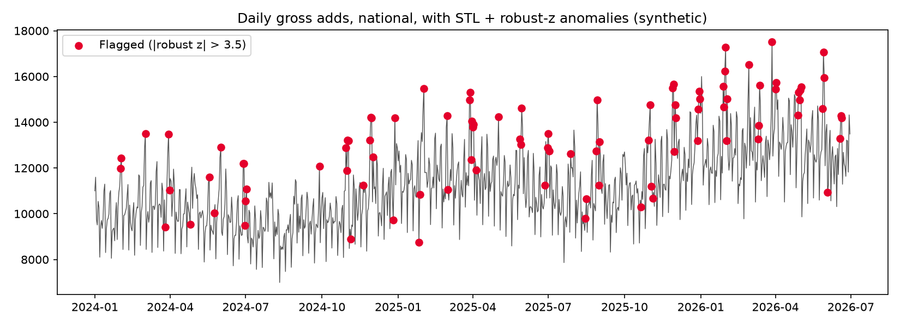
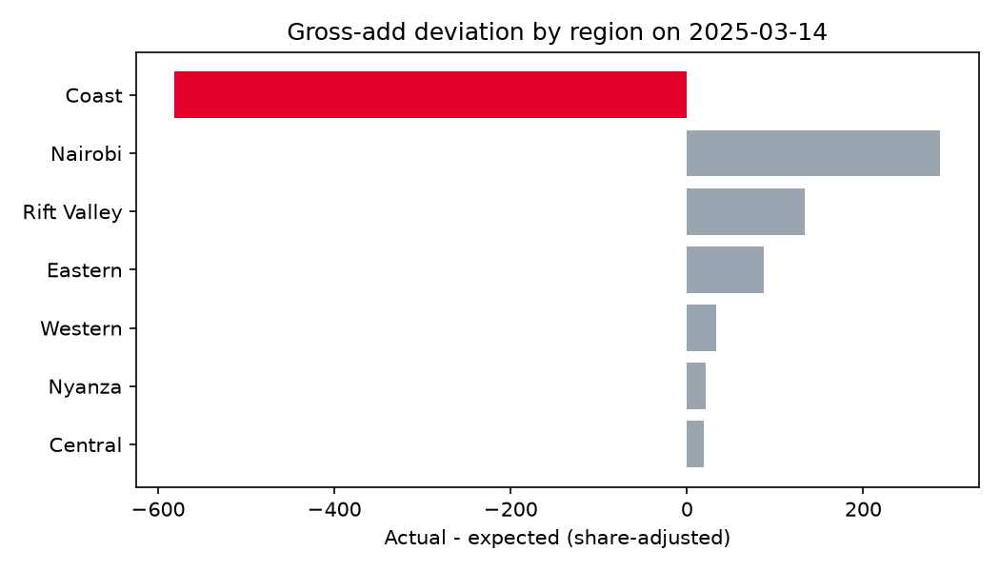
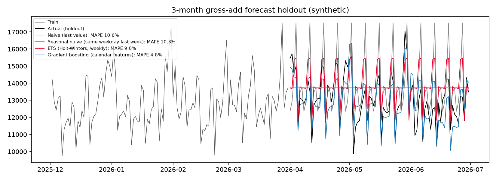

# Telco KPI Anomaly Detection, Root-Cause Analysis & Gross-Add Forecasting

[](https://github.com/ChristopherKiokoStrathmore/telco-anomaly-rca/actions/workflows/ci.yml)

> **Data notice:** all data here is **synthetic**, generated by a seeded script (`src/anomaly/data.py`, seed 11):
> daily KPIs from Jan 2024 to Jun 2026 for 7 Kenyan regions × 4 channels × agents, with **four injected incidents**
> as ground truth. It is **not** Airtel data or data from any other operator.

## Problem
Daily KPI dashboards (gross adds, airtime recharges, agent float) move every day because of weekends, paydays and
seasonality. The analytics team needs to (1) tell real incidents from noise, (2) find the root cause fast, by region,
channel and agent, and (3) forecast gross adds with an error the business understands.

## Approach
1. **Detection:** STL decomposition (weekly, robust) and a **robust z-score** (median/MAD) on residuals. Each
   region × channel series is scanned as a *share of the national total*, which cancels common shocks such as paydays.
   **IsolationForest** on the day × segment |z| matrix is a secondary day-level screen.
2. **Root-cause drill-down:** contribution analysis compares actual values with what each segment's usual share of
   today's total predicts, ranks segments by share of the deviation, and drills down greedily region → channel → agent.
3. **Forecasting:** a 91-day (3-month) holdout comparing Naive, Seasonal-naive, ETS (Holt-Winters) and Gradient
   Boosting on calendar features (weekday, payday, day-of-year) with a linear trend, scored with **MAPE and WAPE**.

## Results (synthetic)
**Detection:** the national series hides every incident (|z| < 2), while the segment scan catches **4/4**, at a 0.5%
segment-day review rate.

| Injected incident | Segment flagged | Drill-down found |
|---|---|---|
| SIM-registration outage, Coast agents | Coast/Agent z = −34 | Coast (100%) → Agent (100%) |
| App payment gateway failure | Nairobi/App z = −26 | Nairobi → App |
| Super-agent float depletion | Western/Agent z = −12 | Western → Agent → **AG-W-03** (100%) |
| Duplicate activation records | Rift Valley/Retail z = +51 | Rift Valley → Retail Shop |

**Forecast, 3-month holdout, national daily gross adds:**

| Model | MAPE | WAPE |
|---|---|---|
| Naive (last value) | 10.6% | 10.0% |
| Seasonal naive (same weekday last week) | 10.3% | 10.2% |
| ETS (Holt-Winters, weekly) | 9.0% | 8.7% |
| **Gradient boosting (calendar features)** | **4.8%** | **4.8%** |





## Alert-to-RCA playbook
1. **Alert fires** (segment |z| ≥ 6). Check whether it's a data issue first: is the feed late, are there duplicates, or did a schema change? (The Rift Valley spike is a duplicate-record example.)
2. **Size it:** actual vs expected and the share of the national deviation.
3. **Drill down** region → channel → agent with `drill_down()`. Stop when one child explains ≥ 70%.
4. **Corroborate** with related KPIs (gross adds ↔ SIM-registration logs; recharges ↔ payment gateway; float ↔ super-agent).
5. **Route the incident:** network/IT (outage), distribution (float), or data engineering (data quality), with the evidence attached.
6. **Close the loop:** label the alert as a true or false positive and retune the thresholds monthly.

## Explaining forecast error to stakeholders
- *"Our gross-add forecast is off by about 5% on an average day (WAPE 4.8%), roughly 450 adds a day at current volumes.
  The simple rule of 'same as last week' is off by about 10%, so the model halves the planning error."*
- Prefer **WAPE** in business reviews: it is weighted by volume, so quiet days don't distort it the way they can distort MAPE.
- Always show a **baseline**. A 5% error means nothing until people know the naive alternative is 10%.
- Report error **by horizon and segment**, and flag known blind spots (promotions, outages, new competitor offers),
  which the model cannot foresee.

## How to run
```bash
pip install -r requirements.txt
pytest -q
PYTHONPATH=src python -m anomaly.run      # writes reports/summary.md + figures
```
`src/anomaly/`: data.py · detect.py · forecast.py · run.py | `notebooks/analysis.ipynb` | `tests/`

MIT licence · Author: Christopher Nguu
